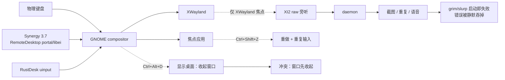
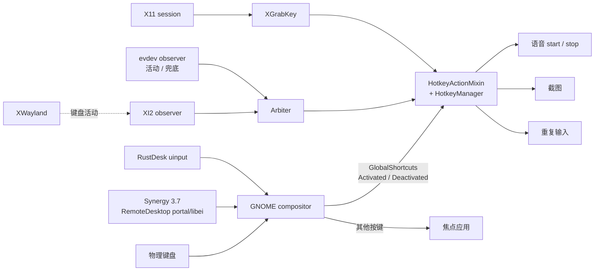
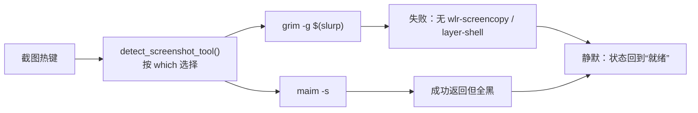

# 全局快捷键与截图链路根治方案

> 日期：2026-10-25  
> 状态：设计已批准并进入实现（2026-10-25）；实现细节见代码与 git diff  
> 范围：全局快捷键输入通道、按键所有权、冲突检测、Wayland 截图与选区浮层  
> 非范围：Whisper/翻译模型、网页录入、历史记录、桌面 UI 视觉重做

---

## 0. 结论

**这不是一个单点 bug，而是三层同时失配：**

1. **按键所有权缺失**：daemon 把全局热键当成“旁听事件”，但 Wayland 下按键归 compositor 所有。GNOME 和 daemon 同时收到同一组键，冲突必然发生。
2. **截图能力探测缺失**：按“二进制是否存在”选择截图工具，而不是按“当前 compositor 支持什么 API”选择。GNOME 不支持 `wlr-screencopy` / `wlr-layer-shell`，grim/slurp 启动即失败；maim 在 XWayland 下拍到全黑；失败又被静默吞掉。
3. **后端与动作耦合**：三个 grabber 各自复制“开始录音 / 停止 / 截图 / 重复输入”逻辑，没有统一的动作状态机；每加一种输入通道就要再抄一遍，且各自使用不同的松开语义。

**根治方向：**

```text
Wayland：GNOME（compositor）拥有按键
          → org.freedesktop.portal.GlobalShortcuts
          → Activated / Deactivated（原生按下/松开）
          → HotkeyActionMixin + HotkeyManager → 动作

X11：    XGrabKey 独占
          → HotkeyActionMixin + HotkeyManager → 动作

截图：   org.freedesktop.portal.Screenshot（整屏）
          → 自绘冻结选区窗口
          → 按选区精确裁剪
          → 现有 OCR / 翻译 / 结果浮层
```

> **实现校正（2026-10-25）**：
> 1. GNOME 50 的 `org.freedesktop.portal.Screenshot` 要求调用者处于焦点，否则返回 `Only the focused app is allowed to show a system access dialog`。后台 daemon 没有前台窗口，已用 2x2 透明 `parent_window`（`x11:<xid>`）+ `modal=true` 实测通过。非交互截图会写入 `~/图片/Screenshot-N.png`，客户端复制到临时文件后删除源文件。
> 2. systemd 服务没有桌面上下文，门户会报 `An app id is required`。已用 `org.freedesktop.host.portal.Registry.Register(app_id, {desktop_entry})` 注册；systemd 单元直接 `exec python`，不再用 `sg`/setgid（setgid 会让进程不可 dumpable，门户无法打开 `/proc/PID/root`）。

**必须先接受的取舍：**

- `Ctrl+Alt+D` 不能同时用于“截图”和“显示桌面”。GNOME 的 `show-desktop` 已包含该组合。
- `Ctrl+Shift+Z` 不能同时用于“重复输入”和“编辑器重做”。
- 任何“只改代码、不改键位”的方案，都只能在“抢走系统/应用功能”和“冲突继续”之间二选一，不存在两边都保留的银弹。

---

## 1. 现场事实（已实测）

| 事实 | 证据 |
| :--- | :--- |
| 会话是 Wayland + GNOME 50.1 | `XDG_SESSION_TYPE=wayland`，`gnome-shell --version` = 50.1 |
| 显示桌面包含 `Ctrl+Alt+D` | `gsettings get org.gnome.desktop.wm.keybindings show-desktop` → `['<Primary><Super>d', '<Primary><Alt>d', '<Super>d']` |
| 修复前截图键是 `Ctrl+Alt+D` | 旧 `.config.json` → `"hotkey_screenshot": "ctrl+alt+d"` |
| 修复前重复键是 `Ctrl+Shift+Z` | 旧 `.config.json` → `"hotkey_repeat": "ctrl+shift+z"` |
| grim 在 GNOME 不可用 | `grim /tmp/x.png` → `compositor doesn't support wlr-screencopy-unstable-v1` |
| slurp 在 GNOME 不可用 | `slurp` → `compositor doesn't support zwlr_layer_shell_v1` |
| maim 在 XWayland 下全黑 | `maim /tmp/x.png` 返回 0，图片 3840×2160，平均色 `(0,0,0)` |
| 门户接口/截图已实测 | Screenshot `version=2`；GlobalShortcuts `version=1`；GlobalShortcuts 绑定成功；Screenshot 需 2x2 焦点父窗口（已实测） |
| 输入源不止物理键盘 | Synergy 3.7.2（RemoteDesktop portal/libei）、RustDesk UInput Keyboard、物理 USB 键盘并存 |
| 修复前守护进程未运行 | `ollama-voice-daemon.service` = disabled，且无 `daemon.py` 进程 |
| systemd 服务需要 app id | systemd 服务下 portal 报 `An app id is required`；用 `org.freedesktop.host.portal.Registry.Register` 注册后绑定成功 |

> 说明：上表的冲突分析针对代码与配置。若你看到“有时有反应有时没有”，还要先确认是否手动启动了另一个 daemon 实例。

---

## 2. 问题清单

| ID | 级别 | 问题 | 证据 | 影响 |
| :--- | :--- | :--- | :--- | :--- |
| P0-1 | 致命 | 截图键与 GNOME「显示桌面」双触发 | `show-desktop` 含 `<Primary><Alt>d`；daemon 同时旁听同一组合 | 先收起所有窗口，截图再失败 |
| P0-2 | 致命 | 重复键与编辑器「重做」双触发 | `Ctrl+Shift+Z` 是通用 redo；daemon 只旁听不消费 | 编辑器重做 + 重复输入同时发生，文本状态错乱 |
| P0-3 | 致命 | Wayland 截图链路全断且静默 | grim/slurp 启动即失败；maim 全黑；`proc.wait()!=0` 直接回“就绪” | 截图翻译功能在 GNOME 上不可用 |
| P1-4 | 高 | Wayland 下 XI2 不是全局热键，且优先级错误 | `daemon.py:3076` 把 `XInputHotkeyGrabber` 排第一；XI2 raw 只在 XWayland 焦点窗口可见；evdev 又看不到 Synergy/libei | 热键是否生效取决于焦点，不可靠 |
| P1-5 | 高 | 没有按键所有权与冲突检测 | `daemon.py:2102` 吞掉 XGrabKey BadAccess；启动无冲突扫描 | 冲突无声发生，用户只能猜 |
| P1-6 | 高 | PTT 松开依赖 50ms 启发式与补发释放 | 三个 grabber 各自 50ms 定时器 + `_release_hotkey_modifiers` + watchdog | 丢 release 时录音卡死、修饰键卡住 |
| P1-7 | 高 | 三个 grabber 复制动作逻辑 | `HotkeyGrabber` / `XInputHotkeyGrabber` / `EvdevHotkeyGrabber` 各自实现 press/release/repeat | 加一种后端再抄一遍，语义容易漂移 |
| P1-8 | 中 | 结果浮层位置用鼠标位置反推 | `sel_x = mouse_x - img_w`，假设永远向右下拖 | 向左上拖、缩放、多屏时浮层错位 |
| P1-9 | 中 | 安装与文档安装不可用工具 | `install.sh:83-84` 在 Wayland 装 grim/slurp；README 宣称 X11 XGrabKey | 用户按文档装完仍然不能用 |
| P2-10 | 中 | 快捷键默认值与配置多源 | daemon/app/setup.html/README/.config.json 各有一份；daemon 的 `save_config` 只写 6 个字段 | 改默认值修不到老用户；回写可能丢字段 |
| P2-11 | 中 | 缺少后端选择/冲突/截图失败测试 | 现有测试集中在语音/API 层 | 回归只能靠手测，容易再次静默 |

---

## 3. 根因分析（5 Whys）

### RC-1：把“全局热键”当成观察问题，而不是所有权问题

```text
Ctrl+Alt+D 为什么会收起窗口？
→ GNOME 的 show-desktop 绑定包含它
为什么会同时触发 daemon？
→ daemon 只旁听、不消费按键
为什么只旁听？
→ Wayland 下 XI2 raw 不是全局 grab，XGrabKey 也抓不到全局键
为什么还在用 XI2？
→ 没有 compositor 级快捷键后端，只有 X11 时代的 XGrabKey 和后来的旁听 fallback
为什么一直没暴露？
→ grab 错误被吞掉，启动没有冲突扫描，测试只覆盖 happy path
根因：daemon 没有“谁拥有这个键”的概念。
```

### RC-2：按“二进制存在”选截图后端，而不是按“compositor 能力”选

```text
为什么 GNOME 上截不到图？
→ grim 缺 wlr-screencopy，slurp 缺 wlr-layer-shell
为什么还选它？
→ detect_screenshot_tool() 只看 shutil.which("grim")，不看 compositor
为什么假设 wlroots？
→ Wayland 支持是按 wlroots 工具链做的，没有针对 GNOME 的能力分支
为什么用户没看到错误？
→ 非零退出直接把状态改回“就绪”，stderr 被 DEVNULL
为什么没有兜底？
→ maim 在 XWayland 全黑；gnome-screenshot 未安装；没有 portal 路径
根因：截图后端是“名字匹配”，不是“能力匹配”。
```

### RC-3：后端与动作耦合，导致多套语义和启发式

```text
为什么三个 grabber 都有一份录音/截图/重复逻辑？
→ 每次加 fallback 都是复制上一个类再改
为什么复制？
→ 没有独立的共享动作层
为什么这会导致冲突难修？
→ 松开语义、自动重复、修饰键清理、浮层关闭分散在三个类里
为什么现在必须重构？
→ 第四个后端（portal）有原生 Activated/Deactivated，硬塞进旧契约会继续长分支
根因：输入后端与业务动作没有分层。
```

### 横切根因：失败不可见

- XGrabKey 的 BadAccess 被 `_ignore_error` 吞掉。
- 截图进程非零退出被当成“就绪”。
- 启动只打印“启用了哪个类”，不打印“这个类在当前会话能不能真正全局”。
- 没有冲突扫描，用户只能通过“窗口突然收起了”反推。

**设计原则：fail loud。** 任何“按键没拿到 / 截图失败 / 门户被拒 / 后端降级”都必须出现在启动报告和状态栏里。

---

## 4. 目标架构

### 4.1 分层

```text
L0 输入源
  物理键盘 / Synergy(RemoteDesktop portal) / RustDesk(uinput) / 旧 KVM(XTEST) / daemon 自身 uinput

L1 按键所有权（二选一，按会话）
  Wayland: PortalGlobalShortcutsBackend（compositor 独占）
  X11:     X11GrabBackend（XGrabKey 独占）
  兜底:    EvdevObserver / XInputObserver（只旁听，必须显式告警）

L2 仲裁
  Arbiter：来源分类、portal 优先、observer 降级、冲突检测、门户实际键位回写

L3 动作控制
  HotkeyActionMixin + HotkeyManager：IDLE / RECORDING 状态机、PTT start/stop、截图代际、重复输入、watchdog

L4 动作
  VoiceRecorder / PortalScreenshotPipeline / RepeatInput / TranslationOverlay
```

### 4.2 快捷键所有权后端

**Wayland 主路径：`org.freedesktop.portal.GlobalShortcuts`**

- 启动时先 `org.freedesktop.host.portal.Registry.Register(app_id, {"desktop_entry": ...})`；否则 systemd 服务下 `CreateSession` 报 `An app id is required`
- `CreateSession` → `BindShortcuts(session, [voice, screenshot, repeat], parent_window, options)`
- 监听 `Activated` / `Deactivated` / `ShortcutsChanged`
- `Activated(id)` → 对应动作；`Deactivated(id)` → 只有 voice 需要停止
- 绑定会话时可能弹一次 GNOME 授权/分配对话框（次数以实现时实测为准）；被拒则显式降级并告警
- 门户返回的实际 trigger 是本次会话的权威值；与 `.config.json` 不一致时记录并提示
- 退出时 `Session.Close()`

**X11 主路径：`XGrabKey`**

- 只抓当前配置的组合 + NumLock/CapsLock 变体
- 注册时捕获 BadAccess → 明确指出“哪个键被谁占用”
- 用 `MappingNotify` 事件驱动重抓，替代 500ms 周期盲抓
- 保留 50ms 自动重复抑制（或改用 detectable auto-repeat，彻底去掉启发式）

**兜底：`EvdevObserver` / `XInputObserver`**

- 只在门户不可用/被拒时承担动作触发，且启动必须打印“按键未独占，可能仍会传给应用”
- `EvdevObserver` 看不到 Synergy libei；`XInputObserver` 只在 XWayland 焦点窗口可见。两者都不能单独作为 Wayland 主路径
- 作为“键盘活动观察器”：关闭结果浮层、卡键检测、注入回流过滤

### 4.3 仲裁与降级（portal 优先；旧 XTEST 仅 portal 不可用时兜底）

同一个物理按键可能被 portal 和 XI2 同时看到（XWayland 有焦点时）。规则：

1. **portal 事件优先**：portal 可用时 observer 的 `actions_enabled=False`，不产生动作，因此不需要去重窗口。
2. **portal 可用时，XI2/evdev observer 只做活动观察，不触发动作**；物理键盘/uinput 交给 portal。XWayland 常把物理键和 XTEST 都归到 `xwayland-keyboard:*`，source-level 区分不可靠，因此 portal 可用时不承诺旧 XTEST 可用。
3. **portal 不可用时**：XI2 / evdev 才升级为动作触发源，并显式告警；有 evdev 时 XInput 只做 XTEST 最佳努力，只有 XInput 时它接管可见按键。
4. **daemon 自身 uinput**：按设备名过滤，任何路径都不触发动作。
5. X11：`XGrabKey` 是唯一动作源；XI2 只做键盘活动。

> 当前机器的 Synergy 3.7.2 使用 RemoteDesktop portal/libei（配置含 `xdpRestoreToken`，二进制含 `PortalRemoteDesktop`/`libei`），所以 portal 能覆盖它。旧版 Synergy/KVM 若仍走 XTEST：portal 不可用时由 evdev/XI2 兜底；portal 可用时不触发，不能保证。

### 4.4 HotkeyActionMixin + HotkeyManager（Controller 的实现）

```text
on_action(VOICE_START)   -> if IDLE: recorder.start(); state=RECORDING
on_action(VOICE_STOP)    -> if RECORDING: recorder.stop(); state=IDLE
on_action(SCREENSHOT)    -> cancel previous generation; start new capture
on_action(REPEAT)        -> if last_result: inject; else status "还没有识别记录"

watchdog: if RECORDING and now-start > VOICE_MAX_SECONDS -> force stop
```

- 三个后端只负责“发动作”，不再各自实现录音/截图/重复。
- `voice_active` / `voice_started_at` 由 controller 暴露，watchdog 和状态栏只依赖 controller。
- 修饰键补发释放只对“需要它的后端”启用（X11 / evdev / XTEST）；portal 路径不注射，避免与 compositor 状态打架。
- 结果浮层“任意键关闭”：优先由浮层自身键盘焦点处理；全局 observer 只做兜底。

### 4.5 截图链路

```text
Action(SCREENSHOT)
  -> 2x2 透明焦点父窗口（portal 要求当前应用在前台）
  -> PortalScreenshotClient.Screenshot(parent_window=x11:<xid>, interactive=false, modal=true)
  -> 全屏 PNG（临时文件 / file:// URI）
  -> SelectionOverlay：冻结全屏画面，自绘选区
  -> 按选区矩形 × scale 裁剪（PIL）
  -> POST /api/ocr_translate
  -> TranslationOverlay 在选区原位显示结果
```

关键点：

- **能力探测**：检查 D-Bus 上 `org.freedesktop.portal.Screenshot` 是否存在、版本 ≥ 1；不再看 `which grim`。
- **取消语义**：每次截图分配 generation token；新触发取消旧选区/旧请求；过期响应直接丢弃。
- **精确几何**：选区在冻结图上计算，浮层位置就是选区矩形；不再用“鼠标释放点 − 图片尺寸”猜。
- **DPI**：裁剪坐标 = 逻辑坐标 × 图像像素/逻辑尺寸比例；单屏 3840×2160 先做精确，多屏按 monitor 分别建窗口。
- **失败可见**：门户被拒、超时、读图失败、OCR 失败都显示明确状态，不再静默回“就绪”。
- **翻译降级**：翻译引擎全挂时 `/api/ocr_translate` 返回 OCR 原文 + warning，daemon 显示原文并标记，不让截图流程整体 502。
- **删除**：`wayland-grim` 分支、`maim` 的 Wayland 回退、`gnome-screenshot` 依赖。

### 4.6 冲突检测与配置

- 启动扫描 GNOME 桌面级快捷键：`wm.keybindings`、`shell.keybindings`、`media-keys`、`mutter.keybindings`、`mutter.wayland.keybindings` + 自定义 keybindings。
- X11 额外用一次瞬时 `XGrabKey` 探测 BadAccess，探测后立即 ungrab。
- 结果写入启动报告：
  - `OK`：键位未被桌面占用
  - `WARN`：与桌面/应用冲突，给出冲突键路径
  - `FALLBACK`：门户不可用，按键未独占
- 设置页保存快捷键时先跑扫描，冲突必须显式确认，不静默接受。
- 门户实际键位与配置不一致时：记录实际值，提示“本次会话实际使用 X”；不要把 daemon 的不完整 `save_config` 直接写回（当前会丢 `custom_keywords`/`baidu_*`）。

---

## 5. 修复前后对比

| 维度 | 现状 | 目标 |
| :--- | :--- | :--- |
| 谁拥有按键 | 无人独占；GNOME + daemon 同时收到 | Wayland = portal；X11 = XGrabKey |
| `Ctrl+Alt+D` | 显示桌面 + 截图（截图失败） | 不再使用；换非冲突键 |
| `Ctrl+Shift+Z` | 编辑器重做 + 重复输入 | 不再使用；换非冲突键 |
| 物理键盘 | XI2 仅焦点内可见 | portal 全局独占 |
| Synergy 3.7（libei） | XI2 仅焦点内可见 | portal 全局独占 |
| RustDesk uinput | XI2 仅焦点内可见 | portal 全局独占 |
| 旧 KVM/XTEST | XI2 可见但不可消费 | portal 不可用时 evdev/XI2 兜底；portal 可用时不触发 |
| PTT 松开 | 50ms 定时器 + 补发释放 + watchdog | portal Deactivated 原生松开 |
| 冲突检测 | 无；BadAccess 被吞 | 启动扫描 + X11 探测 + 显式告警 |
| 截图后端 | grim/slurp 失败；maim 全黑 | portal Screenshot |
| 截图失败反馈 | 静默回“就绪” | 明确错误 + 状态栏 |
| 选区几何 | 鼠标位置反推，假设右下拖 | 冻结图上的精确矩形 + DPI 换算 |
| 动作逻辑 | 3 份复制 | 1 套共享动作层（ActionMixin + Manager） |
| 安装依赖 | Wayland 装 grim/slurp | 去掉 grim/slurp；加 portal 能力检查 + python3-dbus |
| 文档 | 宣称 X11 全局热键 | 分 Wayland/X11 写清所有权与降级 |

### 5.1 当前快捷键事件流



### 5.2 目标快捷键事件流



### 5.3 当前截图链路



### 5.4 目标截图链路


---

## 6. 收益

1. **冲突归零**：选定键位后，桌面/应用不再和 daemon 同时收到同一动作。
2. **PTT 语义正确**：portal 的 `Activated`/`Deactivated` 是原生按下/松开，不再靠 50ms 定时器猜。
3. **覆盖当前输入源**：物理键盘、Synergy（libei）、RustDesk（uinput）由 portal 覆盖；旧 KVM/XTEST 仅在 portal 不可用时兜底。
4. **截图真正可用**：GNOME 上走 portal，不再依赖 wlroots 私有协议；失败可见。
5. **浮层位置正确**：选区矩形直接来自冻结图，不再假设拖拽方向。
6. **可维护性**：动作逻辑从 3 份收敛到 1 份；新增后端只实现“发事件”。
7. **可诊断性**：启动报告明确“谁拥有按键 / 是否降级 / 哪个键冲突”。
8. **少改系统**：不写 GNOME 自定义快捷键，不修改 `show-desktop`/`redo` 的系统配置；门户授权是显式的、可撤销的。
9. **减少启发式**：portal 路径不再需要补发修饰键释放、幽灵修饰键检测等 X11/XTEST 补丁；这些只保留在真正需要的 fallback 路径。

**设计目标（验收时验证，不是当前实测）：**

| 指标 | 现状 | 目标 |
| :--- | :---: | :---: |
| 桌面级硬冲突 | 2 | 0 |
| 静默失败路径 | 3 | 0 |
| GNOME 可用截图后端 | 0 | 1 |
| 动作逻辑副本 | 3 | 1 |
| 覆盖输入源 | 3/5 | 5/5 |
| PTT 原生松开 | 无 | 有 |

---

## 7. 实施计划

### Phase 0：取证与护栏（0.5–1 天）

- 新增快捷键冲突扫描（只读，不改行为）。
- 启动报告打印：会话、后端候选、门户版本、当前键位冲突、截图能力。
- 为 `_parse_hotkey` / evdev 解析 / accelerator 归一化加测试。
- **退出标准**：启动报告能准确指出 `Ctrl+Alt+D`（桌面级）冲突；`Ctrl+Shift+Z` 是应用级 redo，无法枚举，通过更换默认值规避；现有测试全绿。

### Phase 1：动作层解耦（1–2 天）

- 引入 `HotkeyActionMixin`（共享动作）与 `HotkeyManager`（选择所有权后端）。
- 把三个 grabber 的录音/截图/重复逻辑迁到 controller；后端只发 `ActionEvent`。
- watchdog、状态栏、浮层关闭改为依赖 controller。
- **退出标准**：X11 / XI2 / evdev 现有行为不变；三个类的重复动作代码删除；单元测试覆盖 start/stop 幂等与 watchdog 强制复位。

### Phase 2：所有权后端（2–3 天）

- 实现 `PortalGlobalShortcutsBackend`（Host Registry → CreateSession → BindShortcuts → Activated/Deactivated/Close）。
- systemd 单元直接 exec Python，移除 `sg`/setgid；补 daemon 专用 `.desktop` 供 Registry 使用。
- 实现 `X11GrabBackend` 的 BadAccess 检测与事件驱动重抓。
- 实现 `BackendSelector`：Wayland→portal，X11→XGrabKey，失败才降级并告警。
- 实现 `Arbiter`：portal 优先；portal 可用时观察器只做活动观察；旧 XTEST 只走 portal 不可用时的 fallback。
- 配置：门户实际 trigger 记录；冲突扫描接入设置页；生成迁移提示。
- **退出标准**：Wayland 下物理/Synergy/RustDesk 三类输入都能全局触发；焦点在 Wayland 与 XWayland 应用时行为一致；portal 被拒时显式降级且不双触发；PTT 连续 100 次无卡死。

### Phase 3：截图链路（2–3 天）

- 实现 `PortalScreenshotClient`（异步 Response、超时、拒绝、URI 解析）。
- 处理 GNOME 门户的焦点要求：临时 2x2 透明父窗口 + `parent_window=x11:<xid>` + `modal=true`。
- 实现 `SelectionOverlay`（冻结全屏、拖选、Esc/右键取消、精确矩形）。
- 裁剪 + DPI 换算 + 复用 `TranslationOverlay`。
- 用 generation token 处理连按/取消；删除 grim/slurp/maim 的 Wayland 分支与安装依赖。
- 更新 `startup_check`、`install.sh`、README、setup 页提示。
- **退出标准**：截图区域与裁剪区域像素级一致；结果浮层在选区原位；连按/取消无残留窗口；门户拒绝/无焦点有明确错误；不再调用 grim/slurp/maim。

### Phase 4：硬化与收口（1–2 天）

- 多屏/分数缩放：每屏一个选区窗口，逐屏映射；单屏先精确。
- 挂起/恢复、热插拔、输入法切换、portal 服务重启。
- 压测：PTT 100 次、截图 50 次、重复输入 50 次、快速连按 20 次。
- 清理旧代码/注释/文档；补充故障排查章节。
- **退出标准**：验收矩阵全过；启动报告无“静默降级”；文档与实际一致。

---

## 8. 验收矩阵

| 场景 | 期望 |
| :--- | :--- |
| Wayland + 物理键盘，焦点在 Wayland 应用 | PTT 按下/松开正确；截图/重复正确 |
| Wayland + 物理键盘，焦点在 XWayland 应用 | 同上，且不双触发 |
| Synergy 3.7（RemoteDesktop portal） | 同上 |
| RustDesk uinput 虚拟键盘 | 同上 |
| 旧 KVM/XTEST（若仍存在） | portal 不可用时 XI2/evdev 兜底；portal 可用时不触发 |
| `Ctrl+Alt+D` 按下 | 不再收起窗口（因为默认键已改；若保留则明确告知会失去 show-desktop） |
| `Ctrl+Shift+Z` 按下 | 不再触发编辑器 redo（默认键已改） |
| 截图选区向右下/左上/任意方向拖 | 裁剪与浮层位置一致 |
| 截图连按 5 次 | 只保留最后一次；无残留窗口/请求 |
| 截图时按 Esc/右键 | 取消，无 OCR 请求，无指针 grab 残留 |
| portal 授权被拒 | 启动/状态栏明确告警；降级路径可用；不静默 |
| portal 服务重启/不可用 | 自动重连或显式降级；不崩溃 |
| systemd 服务运行 | Host Registry 注册成功；portal GlobalShortcuts 绑定；无 `An app id is required` |
| X11 会话 | XGrabKey 独占；冲突 BadAccess 可见 |
| 100 次 PTT | 无卡键、无录音卡死、无 watchdog 误杀 |
| 结果浮层打开时按任意键 | 浮层关闭；不误触发新动作 |
| 多屏/分数缩放 | 单屏精确；多屏逐屏映射，跨屏拖选有明确限制 |

---

## 9. 风险与待拍板

### 风险

| 风险 | 可能性 | 影响 | 缓解 |
| :--- | :---: | :---: | :--- |
| 门户授权被拒/企业策略禁用 | 中 | 高 | 显式降级 + 告警；提供 evdev fallback |
| systemd 服务无 portal app id | 高 | 高 | Host Registry 注册 app_id + desktop_entry；已实测 |
| `sg`/setgid 导致门户读不到 /proc/root | 中 | 高 | 服务单元直接 exec Python；用户组由 user manager 继承 |
| portal 访问对话框要求焦点 | 高 | 高 | 截图前创建 2x2 透明焦点父窗口，传 `parent_window` + `modal=true`；已实测 |
| 非交互截图写入 ~/图片 | 高 | 低 | 复制到临时文件后删除 portal 源文件 |
| GNOME 版本差异导致 portal 行为不同 | 中 | 中 | 能力探测 + 版本分支 + 集成测试 |
| 多屏/分数缩放映射错误 | 中 | 高 | 单屏精确；多屏逐屏窗口；实机验收 |
| XWayland 源合并，XTEST 无法可靠区分 | 高 | 中 | portal 为主；观察器在 portal 可用时不触发；文档明确限制 |
| 老配置仍带冲突键 | 高 | 中 | 启动扫描 + 迁移提示；不静默覆盖 |
| D-Bus/portal 崩溃 | 低 | 高 | 超时、重连、fallback、状态可见 |
| 用户不适应新键位 | 高 | 低 | 设置页可选择/扫描；保留自定义 |
| 多显示器跨屏拖选 | 中 | 中 | 明确限制；后续按需加 GNOME Shell 扩展 |

### 待拍板

1. **默认键位**：截图/重复必须换。建议先跑冲突扫描，再由你选定。候选（需扫描确认）：
   - 语音：`ctrl+alt+z`（当前配置，GNOME 桌面级未占用）
   - 截图：`ctrl+alt+x`
   - 重复：`ctrl+alt+r`
   - 避免：`ctrl+alt+d`（show-desktop）、`ctrl+shift+z`（redo）、`ctrl+alt+t`（终端）、`ctrl+alt+delete`（注销）、`ctrl+alt+F1-F12`（VT）、`alt+a`（GNOME 截图 UI）。应用级冲突无法穷举；portal 会消费绑定键，请选一个你不需要在应用里用的组合。
2. **是否保留 `Ctrl+Alt+D`**：保留 = 夺走“显示桌面”；不保留 = 换键。推荐换键。
3. **是否接受 portal 授权弹窗**：GlobalShortcuts 可能每次会话一次；Screenshot 首次可能一次；实现时实测。推荐接受。
4. **多屏范围**：本期单屏精确 + 多屏逐屏；跨屏拖选后续再做。
5. **旧 KVM/XTEST 兼容**：portal 不可用时保留 XI2/evdev 兜底；portal 可用时只承诺当前输入源（物理/Synergy/RustDesk）。
6. **实际 trigger 回写**：推荐记录并提示；是否自动写回 `.config.json` 需你确认（涉及配置合并语义）。

---

## 10. 代码触点

| 文件 | 现状 | 计划 |
| :--- | :--- | :--- |
| `daemon.py:3076` | 三级 fallback 选择 grabber | 改为 `BackendSelector`：Wayland portal / X11 XGrabKey / fallback |
| `daemon.py:2087` | `HotkeyGrabber`（XGrabKey） | 抽出 `X11GrabBackend`；加 BadAccess 检测 |
| `daemon.py:2278` | `XInputHotkeyGrabber` | 拆成 `XInputObserver`（活动 + portal 不可用时的兜底） |
| `daemon.py:2636` | `EvdevHotkeyGrabber` | 拆成 `EvdevObserver` + fallback 动作源 |
| `daemon.py` `_register_portal_host_app` | 新增 | Host Registry 注册 app_id/desktop_entry |
| `systemd/ollama-voice-daemon.service` | `sg input` + 非 dumpable | 直接 exec Python；补充 daemon desktop 文件 |
| `daemon.py:1014` | `detect_screenshot_tool` 按 which | 改为 portal 能力探测 |
| `daemon.py:1878` | `screenshot_translate` 启 grim/maim | 改为 portal 截图 + 选区窗口 |
| `daemon.py:1924` | `_do_screenshot_translate` 静默失败 | 明确错误 + generation token |
| `daemon.py:1475` | 结果浮层只处理 Esc | 任意键关闭 + 全局 observer 兜底 |
| `daemon.py:788` | watchdog 依赖 grabber | 改为依赖 `HotkeyManager` |
| `daemon.py:130` | `save_config` 只写 6 字段 | 若需回写，改成合并写（与 `app.py:71` 一致） |
| `install.sh:83-84` | Wayland 装 grim/slurp | 去掉；加 `python3-dbus` 与 portal 检查 |
| `static/setup.html:576` | 快捷键 fallback 硬编码 | 改为从 API/扫描结果读取；冲突提示 |
| `README.md:160` | 宣称 X11 XGrabKey 全局 | 分 Wayland/X11 说明所有权与降级 |

---

## 11. 一句话总结

**把“热键”从“我听见了什么”改成“谁拥有这个键”：Wayland 交给 GNOME 门户，X11 交给 XGrabKey，旧的 XTEST/KVM 在 portal 不可用时兜底；截图同理，从“找 wlroots 工具”改成“向 compositor 要一张整屏图，在自己的窗口里选”。** 键位冲突则必须通过换键解决——这是产品取舍，不是代码能变出来的能力。
